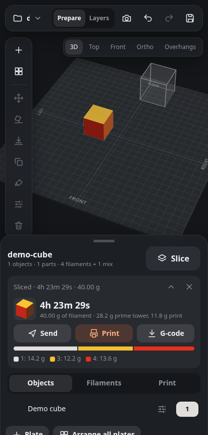

# U1 Web Slicer

A phone-first web slicer for the **Snapmaker U1** (four toolheads, Full Spectrum colour mixing). It runs on a small
home server, drives the real **Snapmaker Orca** slicing engine through its command line, and sends the result to the
printer over Moonraker. Every browser tab, phone and AI agent (via MCP) edits the same live session.

It is deliberately not a universal slicer: the printer profile, presets and printer integration are U1-only.



## Features

- **Projects**: open Orca/Bambu 3MF projects (multi-plate, painted, with modifiers), import STL / 3MF / ZIP, save back
  to an Orca-compatible 3MF.
- **Scene editing**: move / rotate / scale gizmo tuned for touch, lay on face, drop to bed, duplicate, arrange
  (spills onto new plates), multiple plates, per-object and per-part settings, modifiers, negative volumes,
  support blockers/enforcers, primitives.
- **Colour**: filament per object or part, colour painting with Orca-compatible paint trees (brush and fill),
  Full Spectrum mixes of 2-4 filaments with pigment-accurate preview, mapping a model's colours onto the
  filaments loaded in the printer (CIEDE2000).
- **Settings**: all ~300 Orca print settings with search, help texts and basic/advanced levels; built-in U1
  process and filament presets; your own profiles.
- **Slicing**: Snapmaker Orca CLI per plate, live progress, time and filament use, G-code layer preview,
  thumbnails embedded for the printer screen, automatic prime tower placement.
- **Printer**: status, temperatures, RFID filament colours, camera with ETA, upload or upload-and-print.
- **Undo/redo** for every edit, shared across all clients and persisted on disk.
- **MCP server** with 45 tools so an AI agent can inspect and edit the same session the user sees.

## How it works

```
browser (static/, vanilla JS + three.js) ──REST + SSE──┐
                                                        ├── server.py ── session.py (state, ops, undo history)
AI agent ── stdio ── mcp_server.py ──────── HTTP ───────┘        │
                                                                 ├── threemf.py   3MF read/write
                                                                 ├── docker exec <container> snapmaker-orca --slice
                                                                 └── printer.py   Moonraker (status, upload, camera)
```

The server holds **one global session**. Browsers are views: they render the state pushed over Server-Sent Events
and send every edit as an operation (`POST /api/op`). See [docs/architecture.md](docs/architecture.md) for the
modules, data layout and HTTP API.

## Requirements

- Linux host with Python 3.11+ and Pillow (`apt install python3-pil` or `pip install pillow`). No other Python
  dependencies; the server uses the standard library.
- **Snapmaker Orca 2.4.1 or newer** command line. The tested setup runs it in a docker container that also mounts
  the data folder; see [deploy/orca](deploy/orca). Setting `U1WEB_ORCA_CONTAINER=` (empty) runs a local
  `snapmaker-orca` binary instead.
- A Snapmaker U1 reachable over the LAN for the printer features (optional).

## Quick start

```sh
git clone https://github.com/chylek/u1-web-slicer && cd u1-web-slicer
cp deploy/env.example .env          # then edit paths and the printer address
docker compose --env-file .env -f deploy/orca/docker-compose.yml up -d   # Orca CLI container
python3 server.py                   # http://<host>:3060
```

To try it, upload [examples/demo-cube.3mf](examples/demo-cube.3mf) from the project menu: a painted cube with a
Full Spectrum orange side (rebuilt by `tools/make_demo.py`).

Open the page on a phone and use the browser's "Install app" to get it as a full-screen app (needs HTTPS, for
example behind the reverse proxy in [deploy/nginx.conf.example](deploy/nginx.conf.example)).
A systemd unit is in [deploy/u1web.service](deploy/u1web.service).

## Configuration

Environment variables, or a `.env` file next to `server.py` (see [deploy/env.example](deploy/env.example)):

| Variable | Default | Meaning |
|---|---|---|
| `U1WEB_DATA` | `~/.local/share/u1web` | jobs, session state, undo history, user presets |
| `U1WEB_MODELS` | `<data>/models` | folder of model subfolders; saved projects go to `<models>/u1web/` |
| `U1WEB_PORT` | `3060` | HTTP port |
| `U1WEB_ORCA_CONTAINER` | `orca-web` | container with the Orca CLI; empty = run it locally |
| `U1WEB_DATA_IN_CONTAINER` | `/jobs` | where `U1WEB_DATA` is mounted inside that container |
| `U1WEB_ORCA_BIN` | `/opt/orca/bin/snapmaker-orca` | slicer executable |
| `U1_HOST` | unset | printer Moonraker `host:port`, e.g. `192.168.1.10:7125` |
| `U1WEB_URL` | `http://127.0.0.1:<port>` | where the MCP server finds the web server |

## Security model

There is **no login** and **one shared session**. This is intentional for a single household on a trusted LAN:
whoever can open the page can edit the plate, slice, upload files and start prints. Do not expose it to the
internet. If you need access control, put it behind a reverse proxy that authenticates (HTTP basic auth, an SSO
proxy, or a VPN such as WireGuard/Tailscale). The provided nginx example only allows private address ranges.

Hardening that is in place: uploads and zip extraction are confined to the models folder (no path traversal),
zips are limited to 2000 files / 1 GB, starting a print is refused while the printer is busy. The MCP
`add_model` tool also accepts absolute paths, because it runs on the server for a trusted local agent.

## MCP (AI agents)

`mcp_server.py` is a dependency-free stdio MCP server. It starts `server.py` if nothing answers. Register it in
your client, for example Claude Code's `.mcp.json`:

```json
{"mcpServers": {"u1web": {"type": "stdio", "command": "python3", "args": ["/path/to/u1-web-slicer/mcp_server.py"]}}}
```

Ask it things like "make the roof red and the walls a 50/50 mix of white and yellow, then slice plate 2".

## Development

```sh
uv run --with pillow --with pytest pytest     # tests (no Orca needed)
uvx ruff format . && uvx ruff check .         # Python format + lint
npm install && npm run fmt && npm run lint    # front-end format + lint (prettier, eslint)
python3 threemf.py some.3mf                   # most modules have a self-check: python3 <module>.py
```

`static/schema.json`, `presets.json`, `filaments.json` and `mixer.json` are generated from a Snapmaker Orca source
checkout by the scripts in `tools/` (see their docstrings). There is no front-end build step.

## Third-party code and data

- [three.js](https://threejs.org) r170 with `OrbitControls` and a modified `TransformControls` (MIT), vendored in
  `static/vendor/`. Changes are marked `u1web:`.
- FilamentMixer pigment mixing coefficients (MIT, Justin Hayes), as shipped in Snapmaker Orca, in `static/mixer.json`.
- `base_project_settings.config`, `static/schema.json`, `presets.json` and `filaments.json` are derived from
  [Snapmaker Orca](https://github.com/Snapmaker/OrcaSlicer) profiles and option definitions (AGPL-3.0), and some
  file-format logic (paint trees, plate layout, mixed filaments) follows its source.
- The slicer itself, Snapmaker Orca (AGPL-3.0), is not bundled; it runs as a separate program.

## License

Copyright (C) 2026 Adam Chylek.

This program is free software: you can redistribute it and/or modify it under the terms of the
[GNU Affero General Public License](LICENSE) as published by the Free Software Foundation, either version 3 of the
License, or (at your option) any later version. It is distributed WITHOUT ANY WARRANTY.

In short: if you run a modified version as a network service, offer its source to the users of that service.
The MIT-licensed parts listed above keep their own licences.
